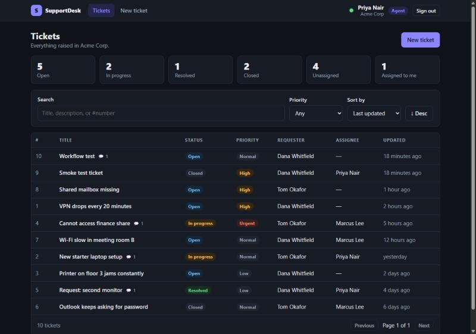
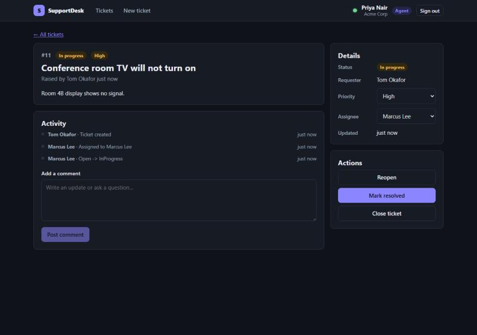
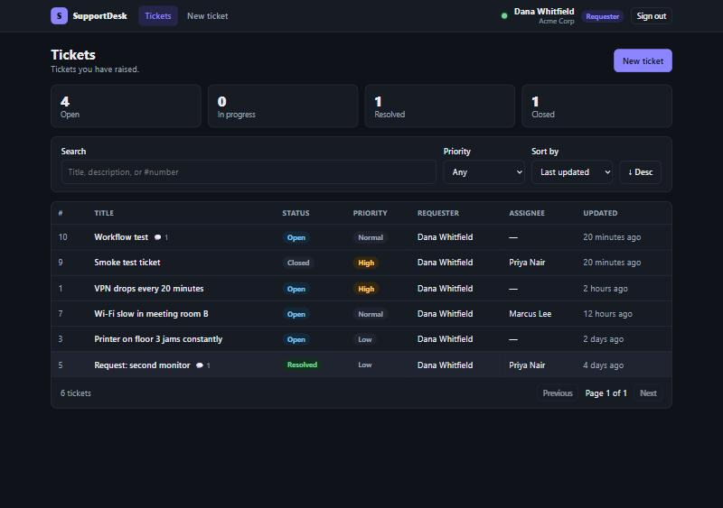
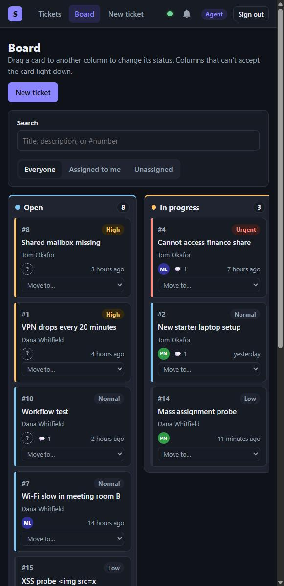
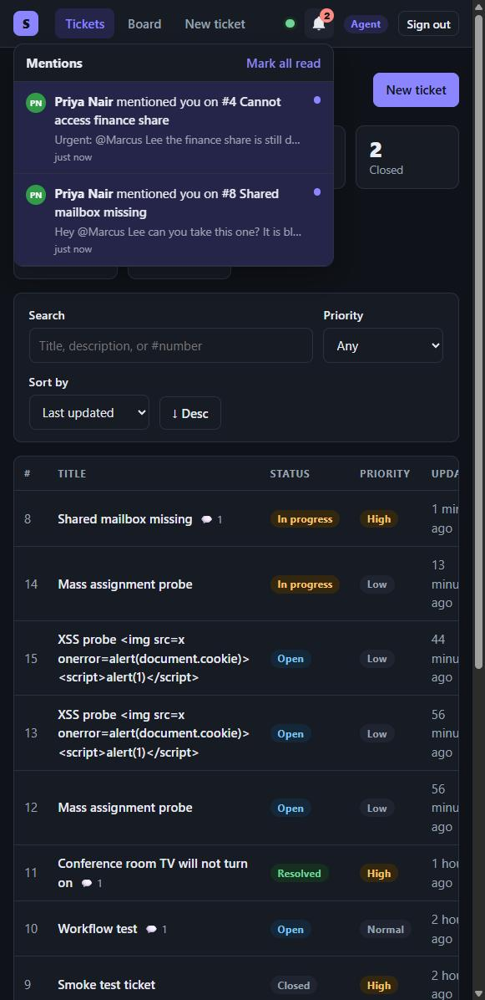
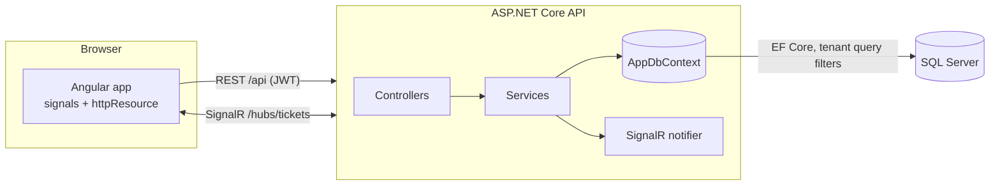

# SupportDesk

[](https://github.com/jrmunger199/SupportDesk/actions/workflows/ci.yml)


A multi-tenant helpdesk. Organisations get private workspaces; requesters raise tickets, agents work them, and **everyone
sees changes the moment they happen**. Built as a full-stack reference: ASP.NET Core 10, SQL Server, SignalR, and a
zoneless, signals-based Angular 22 front end.



| Ticket detail (agent) | Requester view |
| --- | --- |
|  |  |

| Kanban board (drag cards between columns) | @mention notifications |
| --- | --- |
|  |  |

## What it does

- **Multi-tenancy.** Sign up an organisation and you get an isolated workspace with its own people and tickets.
  One organisation can never read or write another's data (enforced in the data layer and covered by tests).
- **Roles.** *Requesters* raise and follow their own tickets. *Agents* work every ticket in their organisation.
  *Admins* also manage people.
- **Ticket workflow.** Open, In progress, Resolved, Closed, with a rules-enforced state machine, priorities,
  assignment, comments, and an append-only audit trail.
- **Live updates.** SignalR pushes changes to the right people only: staff hear about their organisation's tickets,
  requesters hear about their own. Boards refresh, rows flash, toasts appear.
- **Safe concurrent editing.** Two agents editing the same ticket cannot silently overwrite each other (optimistic
  concurrency with SQL Server `rowversion`); the loser gets a clear "someone else changed this" prompt.
- **Search, filter, sort, page** on the ticket list, plus per-status counts.
- **Kanban board.** Every status is a column; drag a card to another column to change its status. Columns that can't
  accept the card (the workflow forbids that move) refuse it and dim while you drag. The move shows instantly, is saved
  with the card's row version, and rolls back with a clear message if the server says no. Every card also has a
  "Move to…" list, so the board works from the keyboard and on touch. It updates live as colleagues move tickets. Clicking a card opens the full ticket in a
  side panel beside the board (the open ticket is in the URL, so it survives a refresh and Back closes it), with
  details, workflow actions, activity and the comment box.
- **@mentions.** Type `@` in a comment or a new ticket's description to tag a colleague: an accessible autocomplete
  suggests only people who can actually open that ticket. Mentioned people get a live notification, a bell with an unread
  count, and an inbox; their name shows as a highlighted chip in the text.

## Tech stack

| Layer | Choices |
| --- | --- |
| API | ASP.NET Core 10 controllers, JWT bearer auth, ProblemDetails errors, rate limiting, health checks, OpenAPI + Scalar |
| Data | EF Core 10, SQL Server, migrations, global query filters, `rowversion` concurrency |
| Real time | SignalR (WebSockets, with long-polling fallback) |
| Web | Angular 22: standalone components, signals, zoneless, `httpResource`, typed reactive forms, lazy routes, view transitions |
| Tests | xUnit v3 (integration tests against real SQL Server), Vitest + Angular TestBed |
| Delivery | GitHub Actions (SQL Server service container), Docker, docker-compose |

## Architecture



```text
src/
  SupportDesk.Domain/   Entities, ticket workflow rules, ITenantContext. No dependencies.
  SupportDesk.Data/     AppDbContext, entity configurations, migrations, tenant isolation.
  SupportDesk.Api/      Controllers, services, auth, SignalR hub, composition root.
tests/SupportDesk.Tests/  145 tests: domain rules + integration tests through the real HTTP/SignalR pipeline.
web/                    Angular app (185 unit tests).
docker/                 Dockerfiles and nginx config. docker-compose.yml at the root.
```

## Run it

You need the **.NET 10 SDK**, **Node 22.22.3+ or 24.15+** (Angular 22's minimum), and SQL Server. On Windows,
LocalDB (installed with Visual Studio) works out of the box.

```bash
# 1. API: applies migrations and seeds demo data on first run (Development only)
dotnet run --project src/SupportDesk.Api --launch-profile http

# 2. Web (in another terminal); proxies /api and /hubs to the API on :5271
cd web
npm install
npm start
```

Open <http://localhost:4200>. In development the sign-in page has one-click demo accounts:

| Account | Role | Organisation |
| --- | --- | --- |
| `admin@acme.test` | Admin | Acme Corp |
| `priya@acme.test` | Agent | Acme Corp |
| `dana@acme.test` | Requester | Acme Corp |
| `admin@globex.test` | Admin | Globex Industries |

Password for all demo accounts: `DemoPass!2026`. Sign in as Acme and Globex in two browsers to see isolation first-hand.

**Not on Windows, or no LocalDB?** Point the API at any SQL Server:

```bash
ConnectionStrings__Default="Server=localhost,1433;Database=SupportDesk;User Id=sa;Password=...;TrustServerCertificate=True" \
  dotnet run --project src/SupportDesk.Api --launch-profile http
```

### Docker

```bash
cp .env.example .env     # then fill in MSSQL_SA_PASSWORD and JWT_KEY (for example: openssl rand -base64 48)
docker compose up --build
```

Compose refuses to start while either secret is empty, and the API refuses to start with a placeholder or development
signing key. Open <http://localhost:8080>. nginx (running as a non-root user) serves the Angular build and proxies `/api`
and `/hubs` to the API, so the browser sees one origin.

Demo data is **off by default** because its accounts have a published password. For a throwaway demo set
`SEED_DEMO_DATA=true`; the accounts above then exist, but the one-click buttons are not in production builds, so type the
email and password. *The compose setup is built and validated by CI; it was written without Docker available locally,
so treat the first local run as the real test.*

## Tests

```bash
dotnet test            # needs SQL Server; locally it uses LocalDB, in CI set SUPPORTDESK_TEST_SQL
cd web && npm test     # Vitest + jsdom, no browser needed
```

The backend integration tests boot the real API in-process (`WebApplicationFactory`) against a throwaway database and
drive it over HTTP and SignalR. Highlights:

- **Tenant isolation** on every endpoint, plus DbContext-level tests that no tenant means no rows and that cross-tenant
  writes are refused. As a sanity check, deleting just the ticket query filter makes 7 tests fail.
- **Concurrency:** 20 parallel ticket creations get unique sequential numbers; two simultaneous edits cannot both win.
- **Real time:** staff, requesters, and other organisations each receive exactly the messages they should, and no more.
- **Security:** tampered and unknown-user tokens, deactivated users losing access immediately (and their live socket being
  cut), account lockout with a fake clock, the password policy, rate limiting per real client behind a trusted proxy (and
  not when the proxy is untrusted), security headers, and indistinguishable "wrong password" vs "unknown email".
  Disabling the revocation logic makes exactly the three relevant tests fail.

## API overview

Interactive docs at `/scalar/v1` when running in Development (OpenAPI at `/openapi/v1.json`).

| Method and path | Who | Purpose |
| --- | --- | --- |
| `POST /api/auth/register` | anyone | Create an organisation and its first admin |
| `POST /api/auth/login` | anyone | Sign in; returns a JWT |
| `GET /api/auth/me` | signed in | Revalidate the session |
| `GET /api/tickets` | signed in | List with `status`, `priority`, `assigneeId`, `unassigned`, `search`, `sort`, `descending`, `page`, `pageSize` |
| `GET /api/tickets/stats` | signed in | Counts by status, unassigned, assigned to me |
| `GET /api/tickets/board` | signed in | Kanban columns with cards (`assigneeId`, `unassigned`, `search`, `perColumn`); cards carry their row version and legal next statuses |
| `POST /api/tickets` | signed in | Raise a ticket |
| `GET /api/tickets/{id}` | signed in | Detail with comments, audit trail, and legal next statuses |
| `PATCH /api/tickets/{id}` | staff | Change status, priority, assignee (send `rowVersion`) |
| `POST /api/tickets/{id}/comments` | signed in | Comment on a ticket (may contain @mentions) |
| `GET /api/mentions` | signed in | Your mentions inbox and unread count |
| `POST /api/mentions/{id}/read`, `POST /api/mentions/read-all` | signed in | Mark your mentions read |
| `GET /api/mentions/candidates` | signed in | People you can mention, optionally for one ticket (`ticketId`, `q`) |
| `GET /api/users` | staff | People in your organisation |
| `POST /api/users`, `PUT /api/users/{id}/active` | admin | Add or deactivate people |
| `/hubs/tickets` (SignalR) | signed in | `ticketChanged` events, and `mentioned` (sent only to the person mentioned) |

Errors are RFC 9457 problem details. Notable codes: `401` bad credentials, `403` wrong role, `404` not found *or not yours*,
`409` stale `rowVersion` or a closed ticket, `422` illegal transition or invalid assignee, `429` rate limited.

## Design decisions

**Tenant isolation in two layers.** Reads go through EF Core global query filters keyed on the caller's tenant; with no
tenant in context the filter value is `Guid.Empty`, so queries **fail closed**. Writes are checked in `SaveChanges`, which
stamps new rows and throws if an entity belongs to a different tenant. Anything that legitimately crosses tenants (sign-in
by email) must say so explicitly with `IgnoreQueryFilters()`, which makes those places easy to audit.

**Shared database, tenant column.** Simple to operate and cheap to scale to many small tenants. The trade-off is that
isolation depends on the filters, hence the heavy test coverage. Database-per-tenant gives stronger isolation at the
cost of operational complexity; the `ITenantContext` seam would let the data layer swap strategies.

**404 instead of 403 for other people's tickets.** A requester asking for someone else's ticket gets "not found", so
the API never confirms that a ticket exists.

**Ticket numbers without races.** The per-tenant counter is incremented with `UPDATE ... SET n = n + 1` inside the same
transaction as the insert. The row lock serialises concurrent creates, so numbers are gapless per tenant and unique.

**Optimistic concurrency, not locks.** Every ticket carries a `rowversion`. Updates echo it back; a mismatch is a `409`
with a human message. The UI also re-fetches when someone else changes the open ticket, so conflicts are rare.

**Push to the right people.** Staff join an organisation group; everyone joins a personal group. The notifier targets
staff plus the ticket's requester, skipping the personal group for staff requesters so nobody gets a message twice.

**Mentions are validated by id, not by name.** Text carries `@[Display Name](user-id)`. The server trusts only the id,
checks that the person exists in the organisation, is active, and could open the ticket (staff, or that ticket's
requester), and rewrites the name to their real one, so a client can't make a mention point at someone else or reveal who
exists elsewhere. The editor hides the token: people type and see `@Priya Nair`, and a pure, unit-tested converter maps
between the two. Mentions are rendered as text nodes, never as HTML. One notification per person per comment, none for
mentioning yourself, and the push goes only to that person's own group.

**The board is a thin view over the same rules.** It reuses the PATCH endpoint, so workflow validation, permissions and
optimistic concurrency apply to a drag exactly as they do to the detail page. Cards ship their legal next statuses, so the
client never duplicates the state machine. Within a column, order is by priority then recency (not manual), which keeps
the API simple and the order stable between users.

**Dates are UTC end to end.** SQL Server returns `DateTime` without a kind, which serialises without a `Z` and is then
parsed as local time by browsers. A value converter marks everything UTC, with a regression test.

**Angular specifics.** Zoneless change detection, signals for all state, `httpResource` for reads (re-fetching when
filter signals change), `linkedSignal` to keep the previous page visible while the next loads, functional guards and
interceptors, route params bound to component inputs, and no UI framework (hand-written, themeable CSS with dark mode).

## Security

**In place**

- **Authentication.** JWTs are validated for signature, issuer, audience and lifetime; the signing key (32+ characters)
  must come from configuration and is checked at startup, and outside Development the API refuses to start with the
  published development key or an obvious placeholder. On every request the account's active state, role and tenant are
  re-checked against a 30-second cache that deactivation invalidates immediately, so deactivating someone ends their
  session at once, and their open SignalR connections are closed. The browser then signs itself out.
- **Passwords.** PBKDF2 via ASP.NET Core Identity with transparent rehashing. New passwords must be 10+ characters and are
  rejected if common, repetitive, or containing the person's email or name. Unknown-email sign-ins verify against a decoy
  hash so timing doesn't reveal which emails exist.
- **Brute force.** Per-IP rate limiting on sign-in and registration, plus per-account lockout (5 failures, 15 minutes). A locked
  account returns the same generic error as a wrong password, and failures are logged by user id, never by password.
- **Behind a proxy.** `X-Forwarded-For` is only trusted from networks listed in `ForwardedHeaders:TrustedNetworks`, so rate
  limiting sees real clients without letting anyone forge the header. nginx overwrites the header rather than appending.
- **Headers.** The API sends `nosniff`, `X-Frame-Options: DENY`, `Referrer-Policy`, COOP, a locked-down CSP, `no-store` on API
  responses, HSTS outside Development, and no `Server` banner. nginx serves the SPA with `script-src 'self'` (the
  production build contains no inline script, and this was checked in a real browser under that policy).
- **Requests.** Bodies over 1 MB are refused with a 413 (not logged as a server error, so oversized requests can't flood
  alerts), inputs are length-limited, and EF Core parameterises every query. `AllowedHosts` restricts which `Host`
  headers the API answers to (compose sets it to `localhost` by default).
- **Secure by default.** CORS allows no origin unless configured (the dev server origin lives only in
  `appsettings.Development.json`), demo seeding is opt-in, and the production bundle is checked in CI to contain no demo
  credentials or source maps.
- **Containers.** Base images are pinned by digest, both services run as non-root users, both have healthchecks (the API
  probes itself, since its runtime image has no curl), and the database and API ports are not published.
- **Isolation.** Tenant filters plus a SaveChanges guard, with tests that fail if either is removed. Mentions respect it
  too: you can't mention (or enumerate) people from another organisation or people who couldn't open the ticket, and
  nobody can read or clear someone else's mentions.
- **Supply chain.** CI fails on known-vulnerable NuGet or npm packages, on any GitHub Action that is not pinned to a full
  commit SHA, and on a production bundle containing demo credentials. CodeQL scans both languages weekly and on every PR,
  and Dependabot proposes updates to packages, images, and action pins.

**Known limitations** (deliberately not hidden)

- The access token lives in `sessionStorage`, readable by injected script. `HttpOnly` cookies with CSRF protection, or a
  backend-for-frontend, would be the next hardening step. There are no refresh tokens or MFA, and the JWT key is symmetric.
- The CSP allows `style-src 'unsafe-inline'` because Angular injects component styles at runtime; per-request nonces would
  remove that.
- Registration answers "email already exists", which reveals whether an address is registered. Fixing it properly needs an
  email-verification flow, which doesn't exist yet (nor do invites or password reset).
- The session cache and the SignalR connection registry are per instance. A scaled-out deployment needs a shared cache and a
  backplane; until then another instance can honour a deactivated user's token for up to 30 seconds.
- Closing sockets when a token expires uses the framework's `CloseOnAuthenticationExpiration` option, which isn't covered
  by an automated test (the shortest token lifetime is a minute).
- The Docker setup is a demo: the API connects as `sa` and trusts the SQL Server's self-signed certificate, and TLS/HSTS must
  be provided where HTTPS is terminated. The pinned SQL Server image is the x86-64 build.
- GitHub Actions are pinned to the latest release of the major version already in use; Dependabot proposes newer majors,
  with CI as the gate.
- Only sign-in and registration are rate limited. Other endpoints (comments, mentions) have no per-user throttle, so a
  signed-in person could flood a colleague's notifications; a global per-user limiter is the next hardening step.
- This has not had an independent penetration test.

## Quality gates

CI runs on every push and pull request: .NET whitespace/line-ending checks, warnings-as-errors with the latest analyzers,
ESLint (including template accessibility rules) and Prettier for the Angular app, both test suites, a check that EF
migrations match the model, dependency vulnerability audits, CodeQL, and Docker image builds.

## License

[MIT](LICENSE)
